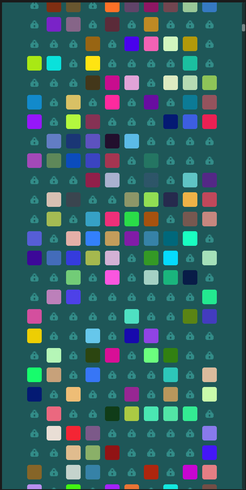

Example Godot (4.8) project to showcase a way to optimize very long (30 k items) scrollable area with color rects.
* The repo is a Godot Engine example project. It targets Godot 4.8.
* It demonstrates a performance technique for a very long scrollable list, about 30,000 items.
* Creating 30k real nodes would be slow. The project shows a way to optimize this utilizing _draw function, tiled background and one repositioned node.

